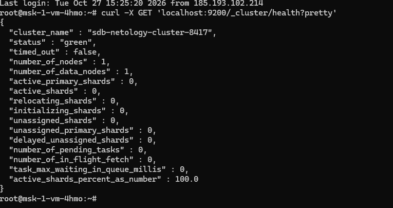
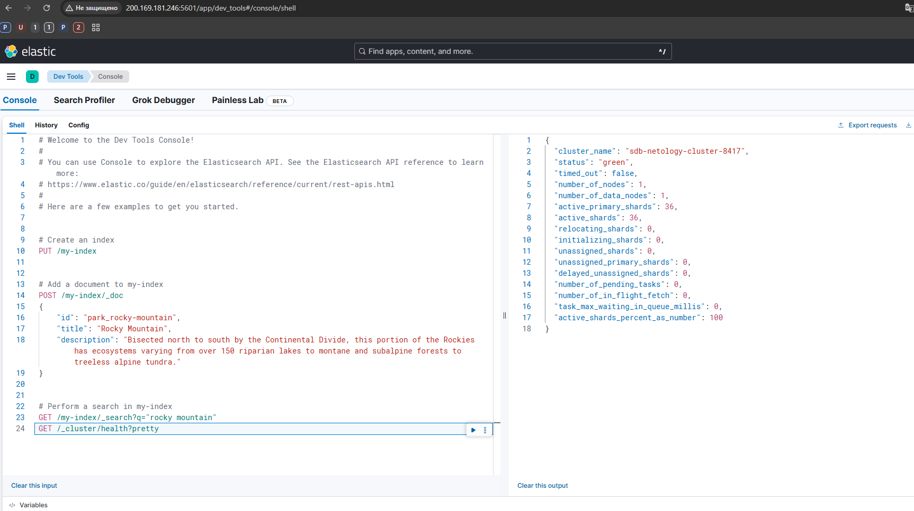
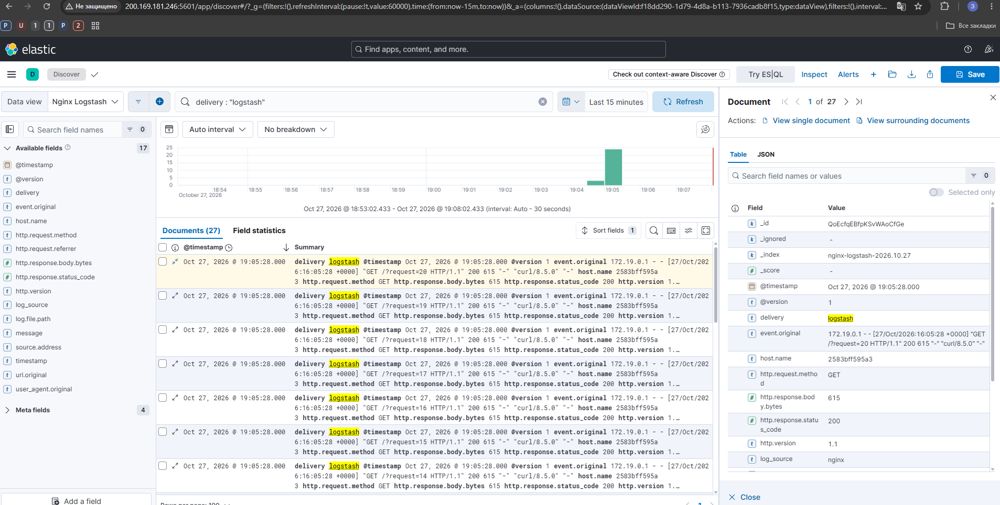
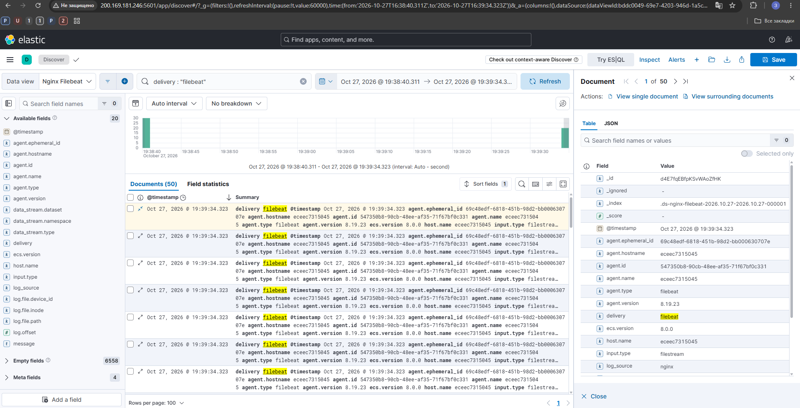

# Домашнее задание к занятию «ELK»

**Выполнил:** Захар Полев

## Задание 1. Elasticsearch

Elasticsearch запущен в Docker на Ubuntu 24.04.

Для кластера задан нестандартный параметр:

```text
cluster.name=sdb-netology-cluster-8417
```

Проверка состояния кластера выполнена командой:

```bash
curl -X GET 'localhost:9200/_cluster/health?pretty'
```

Результат:



---

## Задание 2. Kibana

Kibana подключена к Elasticsearch.

В Dev Tools выполнен запрос:

```text
GET /_cluster/health?pretty
```

В ответе отображается кластер `sdb-netology-cluster-8417` со статусом `green`.



---

## Задание 3. Logstash

Запущены Nginx и Logstash.

Nginx пишет access-лог в файл:

```text
/var/log/nginx/access.log
```

Logstash читает этот файл, разбирает записи и отправляет их в Elasticsearch в индекс:

```text
nginx-logstash-*
```

Для идентификации способа доставки к событиям добавлено поле:

```text
delivery = logstash
```

В Kibana Discover отображаются access-логи Nginx, доставленные через Logstash:



Конфигурация Logstash:

[`logstash/pipeline/logstash.conf`](./logstash/pipeline/logstash.conf)

---

## Задание 4. Filebeat

Поставка логов Nginx была переключена с Logstash на Filebeat.

Logstash остановлен, Filebeat читает тот же access-лог Nginx и отправляет события напрямую в Elasticsearch в индекс:

```text
nginx-filebeat-*
```

Для идентификации способа доставки к событиям добавлено поле:

```text
delivery = filebeat
```

В Kibana Discover отображаются логи Nginx, отправленные через Filebeat:



Конфигурация Filebeat:

[`filebeat/filebeat.yml`](./filebeat/filebeat.yml)

---

## Конфигурация стенда

Все компоненты развернуты на одной виртуальной машине Ubuntu 24.04 в Docker:

- Elasticsearch 8.19.23
- Kibana 8.19.23
- Logstash 8.19.23
- Filebeat 8.19.23
- Nginx

Docker Compose:

[`docker-compose.yml`](./docker-compose.yml)
